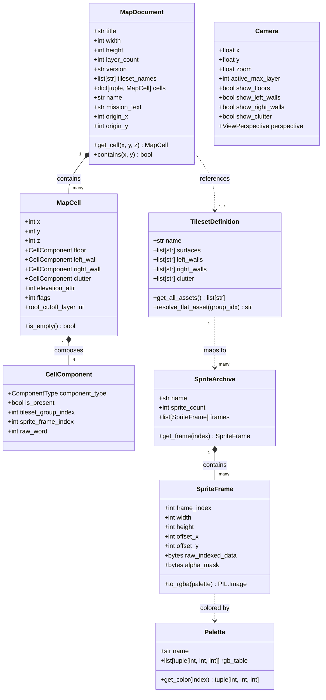

# Data Model: Soldiers at War Map Visualizer

**Feature**: `001-map-visualizer` | **Date**: 2026-10-11

This document defines the core domain models, data structures, and relationships for the Soldiers at War map visualizer. All models are decoupled from any specific GUI or rendering library.

---

## 1. Domain Entities & Relationships

---

## 2. Entity Specifications

### 2.1 MapDocument
Represents the loaded game map file and its associated mission parameters.

| Field | Type | Description | Validation |
|---|---|---|---|
| `title` | `str` | Tileset name decoded from the 128-byte header buffer | Non-empty string |
| `name` | `str` | Map file stem (display name) | May be empty for synthetic documents |
| `mission_text` | `str` | Briefing text of the companion `.txt` file | May be empty |
| `version` | `str` | Stream version string (`"19"`, `"20"` or `"21"`) | Must be one of the three |
| `width` | `int` | Playable window width (columns) | $20 \le \text{width} \le 130$ |
| `height` | `int` | Playable window height (rows) | $20 \le \text{height} \le 100$ |
| `origin_x` | `int` | First grid column of the playable window | $0 \le \text{origin\_x}$, $\text{origin\_x} + \text{width} \le 130$ |
| `origin_y` | `int` | First grid row of the playable window | $0 \le \text{origin\_y}$, $\text{origin\_y} + \text{height} \le 100$ |
| `layer_count` | `int` | Number of elevation levels (fixed at 7) | Must equal `7` |
| `tileset_names`| `list[str]`| Companion `.set` definition referenced by the map (the header name) | At least 1 entry when parsed from a file |
| `cells` | `dict[tuple[int, int, int], MapCell]` | Cells of the playable window indexed by absolute grid `(x, y, z)` | Keyed by coordinates inside the window |

### 2.2 MapCell
Represents a discrete 3D spatial cell at coordinate $(X, Y, Z)$.

| Field | Type | Description | Validation |
|---|---|---|---|
| `x` | `int` | Absolute grid column index | $\text{origin\_x} \le x < \text{origin\_x} + \text{width}$ |
| `y` | `int` | Absolute grid row index | $\text{origin\_y} \le y < \text{origin\_y} + \text{height}$ |
| `z` | `int` | Vertical elevation layer index | $0 \le z < 7$ |
| `floor` | `CellComponent` | Floor / terrain surface component | Required |
| `left_wall` | `CellComponent` | Left-facing wall component | Required |
| `right_wall`| `CellComponent` | Right-facing wall component | Required |
| `clutter` | `CellComponent` | Clutter / structure / object component | Required |
| `elevation_attr`| `int` | Raw attribute byte at stream offset `+8` (meaning unknown) | $0 \le \text{val} \le 255$ |
| `flags` | `int` | 32-bit flags; bits 18–20 are the floor cover level (`roof_cutoff_layer`) | Standard integer |

### 2.3 CellComponent
Represents an individual structural piece within a cell.

| Field | Type | Description |
|---|---|---|
| `component_type` | `ComponentType` | Enum: `FLOOR`, `LEFT_WALL`, `RIGHT_WALL`, `CLUTTER` |
| `is_present` | `bool` | True if bit 15 was set (`word >> 15 & 1`) |
| `tileset_group_index` | `int` | Object group index in the flat tileset registry (`word & 0x7F`) |
| `sprite_frame_index` | `int` | Frame index within the target sprite archive (`word >> 7 & 0xFF`) |
| `raw_word` | `int` | Original 16-bit integer read from stream |

### 2.4 TilesetDefinition
Parsed from companion `.set` files.

| Field | Type | Description |
|---|---|---|
| `name` | `str` | Name of the set (e.g. `Airfield`) |
| `surfaces` | `list[str]` | List of `.obj` asset names for floors (`s*`) |
| `left_walls` | `list[str]` | List of `.obj` asset names for left walls (`l*`) |
| `right_walls`| `list[str]` | List of `.obj` asset names for right walls (`r*`) |
| `clutter` | `list[str]` | List of `.obj` asset names for clutter/objects (`c*`) |

Group indices are resolved through the flat registry returned by `get_all_assets()`: surfaces, left walls, right walls, and clutter in file order, followed by the built-in archives `Cgendam`, `Can`, `Token`, `People`, `Turret`.

### 2.5 Palette
Represents a 256-color indexed lookup table.

| Field | Type | Description |
|---|---|---|
| `name` | `str` | Identifier (e.g. `"Win.pal"`, `"Darkpal.col"`) |
| `rgb_table` | `list[tuple[int, int, int]]` | 256 RGB tuples, each element in range $0 \dots 255$ |

### 2.6 Camera & Viewport State
Manages viewing transformations and interactive filters.

| Field | Type | Default | Description |
|---|---|---|---|
| `x`, `y` | `float` | `(0.0, 0.0)` | World screen center offsets |
| `zoom` | `float` | `1.0` | Zoom factor ($0.25 \le \text{zoom} \le 4.0$) |
| `active_max_layer`| `int` | `6` | Maximum visible elevation ($0 \dots 6$) |
| `show_floors` | `bool` | `True` | Visibility toggle for floors |
| `show_left_walls` | `bool` | `True` | Visibility toggle for left walls |
| `show_right_walls`| `bool` | `True` | Visibility toggle for right walls |
| `show_clutter` | `bool` | `True` | Visibility toggle for objects/clutter |
| `perspective` | `ViewPerspective` | `ISOMETRIC` | `ISOMETRIC` or `TOP_DOWN` |
| `show_minimap` | `bool` | `True` | Minimap corner overlay toggle |
| `show_sidebar` | `bool` | `False` | Detailed inspection sidebar toggle |
| `show_metadata` | `bool` | `False` | Map metadata dialog toggle |
| `isolated_layer` | `Optional[int]` | `None` | When set, only this elevation layer is rendered |
