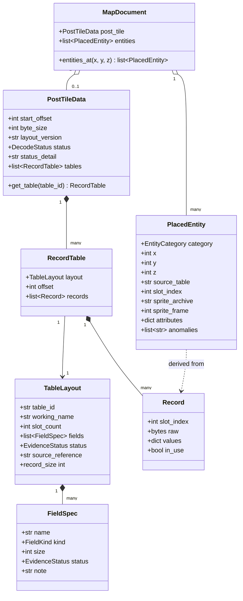

# Data Model: Post-Tile Map Records

**Feature**: `002-post-tile-records` | **Date**: 2026-10-11

Domain entities added by this feature. All are plain data, independent of any rendering
library, and extend the model of feature 001 (`MapDocument`, `MapCell`, `TilesetDefinition`).

---

## 1. Entities & Relationships

---

## 2. Entity Specifications

### 2.1 PostTileData
Everything decoded from the stream after the tile array.

| Field | Type | Description | Validation |
|---|---|---|---|
| `start_offset` | `int` | Stream offset of the first post-tile byte | Equals header size + tile array size (`1,183,193`) |
| `byte_size` | `int` | Bytes between `start_offset` and the end of the stream | $\ge 0$ |
| `layout_version` | `str` | Name of the layout used to decode (`"21"`), empty when undecoded | — |
| `status` | `DecodeStatus` | `DECODED`, `UNSUPPORTED_VERSION`, `SIZE_MISMATCH`, or `MISSING` | — |
| `status_detail` | `str` | Human-readable explanation when status is not `DECODED` | Non-empty unless `DECODED` |
| `tables` | `list[RecordTable]` | Tables in stream order | Empty unless `DECODED` |

**Invariant (FR-002)**: when `status` is `DECODED`, the sum of `slot_count × record_size` over
all tables equals `byte_size`.

**State**: a map always ends in exactly one status. Any status other than `DECODED` leaves the
tile grid usable and `entities` empty (FR-004).

### 2.2 TableLayout
Static description of one table: the reverse-engineered knowledge.

| Field | Type | Description |
|---|---|---|
| `table_id` | `str` | Stable identifier derived from the destination global, e.g. `T-554F60` |
| `working_name` | `str` | Provisional readable name, e.g. `soldier_positions` |
| `slot_count` | `int` | Fixed number of record slots |
| `fields` | `list[FieldSpec]` | Fields in stream order |
| `status` | `EvidenceStatus` | Evidence status of the table's interpretation |
| `source_reference` | `str` | Decompilation line range the layout was transcribed from |

`record_size` is the sum of the field sizes.

### 2.3 FieldSpec

| Field | Type | Description |
|---|---|---|
| `name` | `str` | Field name; generic (`field_00`) while unknown |
| `kind` | `FieldKind` | `U16`, `U32`, `I32`, `BYTES`, `CELL_REF` (32-bit cell index), `U16_ARRAY` |
| `size` | `int` | Size in bytes |
| `status` | `EvidenceStatus` | `CONFIRMED`, `HYPOTHESIS`, or `UNKNOWN` |
| `note` | `str` | Evidence citation for `CONFIRMED`, reasoning for `HYPOTHESIS` |

**Rule (FR-016)**: a field may be `CONFIRMED` only with a non-empty `note` citing evidence.

### 2.4 RecordTable and Record

| Field | Type | Description |
|---|---|---|
| `RecordTable.offset` | `int` | Stream offset of the table |
| `Record.slot_index` | `int` | Position of the record in its table |
| `Record.raw` | `bytes` | Exact bytes of the record (FR-003) |
| `Record.values` | `dict[str, value]` | Decoded field values keyed by field name; `CELL_REF` decodes to `(x, y, z)` or `None` |
| `Record.in_use` | `bool` | False for slots holding the table's empty pattern (FR-008) |

### 2.5 PlacedEntity
A record interpreted as something standing on the map.

| Field | Type | Description | Validation |
|---|---|---|---|
| `category` | `EntityCategory` | `SOLDIER`, `CONTAINER`, `ITEM`, `ZONE`, `TURRET`, `UNIDENTIFIED` | — |
| `x`, `y`, `z` | `int` | Absolute grid cell and level | $0 \le x < 130$, $0 \le y < 100$, $0 \le z < 7$ |
| `source_table` | `str` | `table_id` of the record it comes from | — |
| `slot_index` | `int` | Slot of that record | — |
| `sprite_archive` | `Optional[str]` | Archive that draws it, when confirmed | `None` → drawn as marker |
| `sprite_frame` | `Optional[int]` | Frame within the archive, when confirmed | — |
| `attributes` | `dict[str, value]` | Further decoded properties (e.g. `side`) | — |
| `anomalies` | `list[str]` | Problems found (outside playable window, unresolved reference) (FR-009) | — |

### 2.6 Enumerations

- **DecodeStatus**: `DECODED`, `UNSUPPORTED_VERSION`, `SIZE_MISMATCH`, `MISSING`.
- **EvidenceStatus**: `CONFIRMED`, `HYPOTHESIS`, `UNKNOWN`.
- **EntityCategory**: `SOLDIER`, `CONTAINER`, `ITEM`, `ZONE`, `TURRET`, `UNIDENTIFIED`.

---

## 3. Changes to Existing Entities

| Entity | Change |
|---|---|
| `MapDocument` | New `post_tile: Optional[PostTileData]`, `entities: list[PlacedEntity]`, and `entities_at(x, y, z)`. `origin_x`, `origin_y`, `width`, `height` are taken from the stored window when `post_tile.status` is `DECODED`. |
| `ComponentType` | New member `ENTITY = 4`, sorted after `CLUTTER` within a cell. |
| `RenderItem` | May reference a `PlacedEntity` instead of a cell component. |
| `Camera` | New `show_entities: bool = True`. |
| `InputAction` | New `TOGGLE_ENTITIES`. |
| `CellInspectionInfo` | New `entities: list[PlacedEntity]` for the inspected cell. |

---

## 4. Initial Table Catalogue (version 21)

Statuses as established in [research.md](research.md); they are updated as implementation
confirms or refutes them.

| `table_id` | Working name | Slots × size | Table status | Entities produced |
|---|---|---|---|---|
| `T-554A80` | `containers` | 40 × 18 | Hypothesis | `CONTAINER` |
| `T-559230` | `zone_cells` | 40 × 6 | Hypothesis | `ZONE` |
| `T-554F60` | `soldier_positions` | 40 × 14 | Confirmed (position) | `SOLDIER` (joined with `T-847E50`) |
| `T-550538` | `groups` | 10 × 180 | Unknown | — |
| `S-543F18` | `playable_window` | 1 × 18 | Confirmed | — |
| `T-558FE8` | `table_558FE8` | 8 × 8 | Unknown | — |
| `T-550328` | `table_550328` | 8 × 8 | Unknown | — |
| `S-884828` | `scalars_884828` | 1 × 6 | Unknown | — |
| `T-847E50` | `soldiers` | 40 × 424 | Confirmed (role), fields mostly unknown | joined into `SOLDIER` |
| `S-847E50B` | `soldier_arrays` | 2 × 80 | Unknown | — |
| `T-883800` | `table_883800` | 40 × 18 | Unknown | — |
| `S-884750` … | `mission_params` (5 blocks) | 198 bytes total | Unknown | — |
| `T-8923C0` | `table_8923C0` | 100 × 6 | Unknown | — |
| `T-892AD0` | `items` | 500 × 18 | Hypothesis | `ITEM` (only slots with a cell) |
| `T-559530` | `table_559530` | 8 × 32 | Unknown | — |
